# 🏦 FinServe Platform — plataforma modular de experiência digital financeira, do conteúdo editorial aos dados reais do Banco Central

### Python 3.10+ · FastAPI · Pydantic · SQLite · PyYAML · JavaScript (ES modules, sem bundler) · SVG · pytest · Playwright · GitHub Actions

[](https://github.com/Yuri-Fernando/FinServe-Digital-Experience-Platform/actions/workflows/ci.yml)
     

> **Projeto autoral de portfólio e estudo. Não é produto Adobe, não executa AEM, não se conecta a banco algum e não simula contas ou transações reais.** Campanhas, conteúdo editorial, testes A/B e Core Web Vitals são **sintéticos**; juros, inflação, câmbio, inadimplência e expectativas de mercado são **dados públicos reais do Banco Central do Brasil**, sempre rotulados com fonte e data de coleta.

<p align="center">
  <a href="docs/images/dashboards/02-mercado-banco-central.png">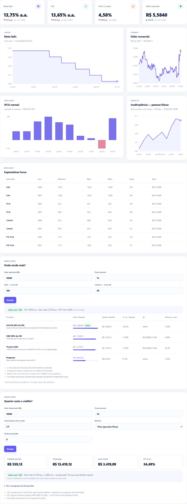</a>
</p>
<p align="center"><sub>Painel <b>Mercado</b>: Selic, dólar, IPCA e inadimplência de pessoas físicas — séries reais do SGS/BCB coletadas em 10/11/2026.</sub></p>

---

## 🟡 Status — MVP técnico funcional (v2.0.0)

🟡 **MVP técnico funcional — núcleo validado: 114 testes automatizados passando (sem rede), 17/17 verificações de navegador com Playwright e relatório de referência reproduzível com dados reais do Banco Central coletados em 2026-11-10.** Backend modular, dashkit, Content Studio com compliance, simuladores e snapshots rodam de ponta a ponta localmente. Pendências: CI no GitHub em execução recorrente, ambientes Linux/macOS verificados localmente e qualquer validação em AEM real.

| Área | Estado | Evidência |
|---|---|---|
| Núcleo modular (registry, CLI, scaffold `new-module`) | ✅ implementado e testado | [`tests/test_platform.py`](tests/test_platform.py) |
| Dados reais do BCB (7 séries SGS + Focus) e snapshots offline | ✅ implementado e testado; coleta real em 2026-11-10 | [`tests/test_bcb.py`](tests/test_bcb.py), [`data/snapshots/`](data/snapshots/) |
| Simuladores de investimento e crédito | ✅ implementado; valores conferidos à mão | [`tests/test_calculators.py`](tests/test_calculators.py), [ADR 0007](docs/adr/0007-calculadoras-puras.md) |
| Analytics (KPIs, anomalias, pacing, A/B, Core Web Vitals) | ✅ implementado; detector testado contra gabarito injetado | [`tests/test_analytics.py`](tests/test_analytics.py), [`tests/test_stats.py`](tests/test_stats.py) |
| Content Studio + compliance YAML + entrega headless | ✅ implementado e testado | [`tests/test_experience.py`](tests/test_experience.py) |
| Front (dashkit, Studio, Portal, mobile) | ✅ validado em Chromium (E2E manual, fora do CI) | [`scripts/e2e_browser.py`](scripts/e2e_browser.py) |
| Relatório de referência | ✅ reproduzível por comando | [`reports/report.md`](reports/report.md), [`reports/metrics.json`](reports/metrics.json) |
| CI (Ubuntu + Windows, Python 3.10/3.12) | 🟡 configurado; ver badge acima | [`.github/workflows/ci.yml`](.github/workflows/ci.yml) |
| Linux / macOS local | ⏳ **não verificado** fora do CI (desenvolvido em Windows 11, Python 3.10.8) | — |
| Adobe AEM (SDK, Cloud Manager, Dispatcher) | ⛔ **não executado** — apenas código de referência | [`aem-reference/`](aem-reference/), [`docs/ROADMAP_AEM.md`](docs/ROADMAP_AEM.md) |
| Estatísticas Pix do BCB | ⏳ não integrado (consulta expirou na verificação) | [ADR 0003](docs/adr/0003-dados-reais-snapshot-proveniencia.md) |

---

## Descrição / Contexto

O **FinServe Platform** é um laboratório para estudar como se constrói uma **experiência digital em serviços financeiros com governança**: o marketing edita campanhas sem deploy, a revisão editorial barra promessas proibidas antes da publicação, a vitrine pública mostra taxas de mercado reais e o time técnico acompanha métricas, anomalias e qualidade da experiência — tudo rastreável.

Mais do que uma aplicação, ele foi desenhado como **ferramenta modular reaproveitável**:

- um **núcleo pequeno** (`registry`, `db`, `audit`, `app`);
- **módulos plugáveis** (`platform`, `experience`, `analytics`, `market`) que declaram rotas, schema, seed, proveniência e dashboards;
- um **kit de dashboards declarativo (dashkit)** que desenha qualquer módulo a partir de uma spec JSON, sem escrever JavaScript novo;
- um **scaffold** (`python -m finserve new-module <nome>`) que cria um módulo novo já com teste.

O nome “FinServe” é fictício; nenhum produto, campanha ou texto representa uma instituição real.

## 🧭 Origem do Projeto

A **v1** era um único módulo FastAPI com dashboard sintético, um CMS simples e um portal (7 testes) — um estudo de experiência digital financeira com foco em governança editorial e no fluxo Author → Publish. A **v2** nasceu da decisão de transformá-la em plataforma reaproveitável e de cruzá-la com os projetos financeiros do mesmo autor antes de escrever código:

| Repositório de origem | O que foi aproveitado (como padrão, não como cópia de código) |
|---|---|
| [Pix-Fraud-Decisioning-Lab](https://github.com/Yuri-Fernando/Pix-Fraud-Decisioning-Lab) | motor de regras em YAML com *reason code* e **fail-safe** → compliance editorial; ADRs; `pyproject`, CLI e Makefile |
| Risco de Crédito | governança de dados (*data card*, *model card*) → [`docs/DATA_CARD.md`](docs/DATA_CARD.md) e proveniência por dataset |
| ReconPilot AI | decisões determinísticas e auditáveis, sempre com motivo |

**Conclusões que definiram a v2:**

1. Dado real e sintético **nunca** se misturam sem rótulo → cada dataset declara `real | synthetic | derived`, fonte, URL e data ([ADR 0003](docs/adr/0003-dados-reais-snapshot-proveniencia.md)).
2. Reaproveitar exige fronteiras claras → registry de módulos com dependências duras e opcionais ([ADR 0001](docs/adr/0001-registry-de-modulos.md)).
3. Um painel novo não deveria exigir JavaScript novo → dashboards como dados ([ADR 0002](docs/adr/0002-dashboards-como-dados.md)).
4. Compliance que erra deve **bloquear**, nunca aprovar em silêncio ([ADR 0004](docs/adr/0004-compliance-yaml-fail-safe.md)).
5. Cálculo financeiro precisa expor suas premissas em cada resposta ([ADR 0007](docs/adr/0007-calculadoras-puras.md)).
6. Integração com AEM só é afirmada com evidência de SDK; até lá, a camada local espelha o **contrato** do Publish, não finge ser AEM ([ADR 0006](docs/adr/0006-entrega-headless-sem-simular-aem.md)).

## 🎯 Objetivo

- Rodar localmente, sem credenciais, com `python run.py` — inclusive **offline** (snapshots do BCB versionados).
- Exibir dados reais do Banco Central com fonte, URL e data de coleta, separados do que é sintético.
- Bloquear, no workflow editorial, promessas de retorno/aprovação garantida e dados pessoais em conteúdo público.
- Entregar conteúdo publicado em formato headless com `ETag`, `Cache-Control` e revalidação 304.
- Medir campanhas com estatística defensável: variação só com janela completa, anomalias robustas, teste A/B com IC e poder.
- Permitir que um módulo novo reaproveite núcleo, dashkit e auditoria sem copiar código.

## 🔬 Linha de Pesquisa / Desenvolvimento

Experiência digital financeira · governança editorial e compliance determinístico · integração de dados públicos (SGS e Olinda/Focus) com proveniência · estatística aplicada a marketing (z modificado, teste de duas proporções, tamanho de amostra) · matemática financeira (IR regressivo, poupança, Price/SAC, CET por TIR) · cache e entrega headless · visualização declarativa e arquitetura de plugins.

## 🏗️ Arquitetura

### Sistema

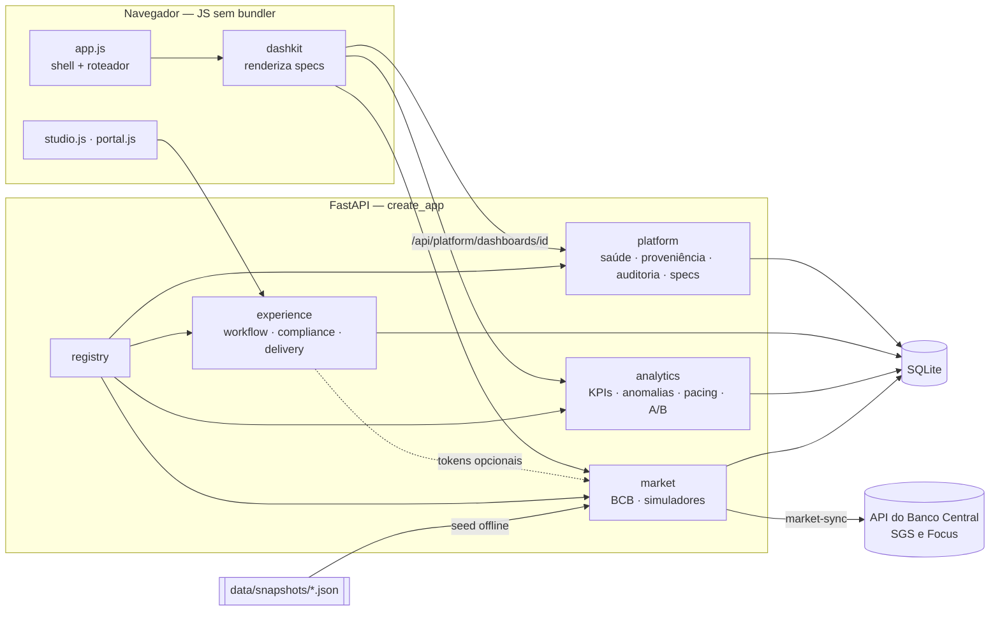

### Camadas

```text
web/  (index.html + dashkit + páginas)          ← só consome JSON; todo texto escapado
  ↓ HTTP/JSON
src/finserve/app.py  create_app(modules)         ← monta apenas os módulos habilitados
  ├─ registry.py   descoberta · requires/optional · ordem · ciclo
  ├─ dashkit.py    contrato e validador de specs
  ├─ audit.py      trilha única (audit_events)
  ├─ report.py     relatório de referência reproduzível
  └─ modules/
       platform/   experience/   analytics/   market/
            ↓            ↓            ↓           ↓
                     SQLite (FINSERVE_DB)    ← snapshots reais do BCB no seed
```

### Módulos

| Módulo | Função | Tabelas | Teste |
|---|---|---|---|
| `platform` | saúde, catálogo de módulos, proveniência, dicionário, auditoria, specs de dashboard | `audit_events` | `test_platform.py` |
| `experience` | workflow DRAFT→IN_REVIEW→APPROVED→PUBLISHED, papéis demo, versões + diff, compliance YAML, tokens de mercado, entrega headless | `content_items`, `content_revisions` | `test_experience.py` |
| `analytics` | KPIs com variação vs. período anterior, CWV p75, anomalias, pacing, A/B, CSV | `campaigns`, `dim_date`, `fact_experience_daily`, `ab_tests`, `ab_variants` | `test_analytics.py`, `test_stats.py` |
| `market` | séries do BCB, Focus, sincronização e snapshots, simuladores | `market_series`, `market_observations`, `market_expectations`, `market_sync_log` | `test_bcb.py`, `test_market_api.py`, `test_calculators.py` |

Semântica dos KPIs e regras de projeto: [`docs/ARCHITECTURE.md`](docs/ARCHITECTURE.md) · Contrato de módulo: [`docs/MODULES.md`](docs/MODULES.md) · Dicionário: [`docs/DATA_DICTIONARY.md`](docs/DATA_DICTIONARY.md).

## 🧩 Módulos e reaproveitamento

```bash
python -m finserve new-module cartoes   # gera __init__.py, router.py, schema.sql e tests/test_module_cartoes.py
python -m finserve modules              # o módulo novo já aparece (descoberta automática)
python -m finserve check                # valida todas as specs de dashboard e as regras de compliance
```

| Como habilitar | Efeito |
|---|---|
| `FINSERVE_MODULES=platform,market` | só esses módulos (o `platform` sempre entra) |
| `create_app(["market"])` | idem, em código e testes |
| `FINSERVE_EXTRA_MODULES=pacote.modulo` | módulo externo, fora do repositório |
| entry point `finserve.modules` | módulo distribuído como pacote pip |

Sem o módulo `market`, o Content Studio continua funcionando e os tokens (`{{selic_meta}}`) resolvem para `—` — nunca para valor inventado ou token cru (teste `test_tokens_degrade_when_market_disabled`).

## 📈 Dashboards declarativos (dashkit)

Um dashboard é um JSON com **filtros**, **fontes** e **widgets**; o renderizador único (`web/assets/dashkit/kit.js`, vanilla JS) desenha KPIs, linhas, barras (com negativos), donut, funil, Core Web Vitals, tabelas ordenáveis com exportação, listas e calculadoras. Os gráficos são SVG com `viewBox` igual à largura real do card e tooltip por ponto. A falha de uma fonte afeta só os widgets dela. Contrato completo: [`docs/DASHKIT.md`](docs/DASHKIT.md).

```json
{"type": "line", "source": "selic", "title": "Meta Selic", "path": "points", "x": "date",
 "series": [{"key": "value", "label": "Meta Selic"}], "format": "num2", "span": 2}
```

## ⚙️ Funcionamento

1. `create_app()` carrega os módulos habilitados, valida dependências e aplica schemas e seeds idempotentes.
2. O seed do `market` carrega `data/snapshots/*.json` (dados reais com data de coleta); `market-sync` atualiza ao vivo.
3. O front pergunta a `/api/platform/dashboards` quais páginas existem; cada dashboard é uma spec renderizada pelo dashkit.
4. No Content Studio, o autor edita; o compliance avalia ao digitar; *Enviar revisão* e *Publicar* são barrados por regras `block` (HTTP 422); avisos ficam na auditoria.
5. Revisor aprova, publicador publica; cada edição gera revisão versionada (diff disponível) e evento de auditoria.
6. O Portal consome só `/api/experience/delivery`, que resolve tokens com dados reais e devolve `ETag`; uma revalidação com `If-None-Match` retorna 304.

```text
Autor ─▶ DRAFT ─▶ IN_REVIEW ─▶ APPROVED ─▶ PUBLISHED ─▶ /delivery (ETag · Cache-Control · 304) ─▶ Portal
            ▲          │                                  └▶ /model/{persona}.model.json (forma do Sling Model Exporter)
            │   compliance YAML (block → 422)              tokens {{selic_meta}} ◀── market (BCB real)
            └──────────┘ rejeitar
```

## 🌐 API

Documentação interativa em `/docs` (OpenAPI). Principais rotas:

| Método e rota | O que faz |
|---|---|
| `GET /api/platform/health` · `/modules` · `/provenance` · `/dictionary` · `/audit` | núcleo: saúde, catálogo, proveniência real × sintético, dicionário, auditoria |
| `GET /api/platform/dashboards` · `/dashboards/{id}` | specs do dashkit |
| `GET /api/market/overview` · `/series` · `/series/{id}?days=` · `/focus` · `/tokens` | dados do Banco Central |
| `POST /api/market/simulate/investment` · `/simulate/loan` | simuladores com premissas na resposta |
| `POST /api/market/sync` (papel `admin`) | sincronização ao vivo com o BCB |
| `GET /api/analytics/dashboard` · `/anomalies` · `/pacing` · `/experiments` · `/export.csv` | analytics de campanhas (sintético) |
| `GET/POST/PUT /api/experience/content` · `POST /content/{id}/transition` · `GET /content/{id}/diff` | workflow editorial |
| `POST /api/experience/compliance/check` · `GET /compliance/rules` | compliance editorial |
| `GET /api/experience/delivery` · `/model/{segmento}.model.json` | camada Publish (headless) |

## 📦 Dados públicos

| Série | Código | Uso na plataforma |
|---|---|---|
| Meta Selic | SGS 432 | KPI, gráfico, simuladores, token `{{selic_meta}}` |
| CDI anualizado (base 252) | SGS 4389 | simuladores, token `{{cdi_anual}}` |
| IPCA mensal | SGS 433 | gráfico de barras, IPCA 12 meses (derivado), retorno real |
| IGP-M mensal | SGS 189 | catálogo de séries |
| Dólar comercial (venda) | SGS 1 | KPI, gráfico, token `{{usd_brl}}` |
| Inadimplência da carteira — **total** | SGS 21082 | catálogo |
| Inadimplência da carteira — **pessoas físicas** | SGS 21084 | KPI e gráfico de crédito |
| Expectativas Focus (Selic, IPCA, Câmbio, PIB) | Olinda `ExpectativasMercadoAnuais` | tabela de expectativas |

Cada código foi consultado na API antes de entrar no catálogo. Séries de taxas médias de crédito sem código e descrição confirmados **ficaram de fora**. Detalhes, licenças e limites: [`docs/DATA_CARD.md`](docs/DATA_CARD.md).

## 🧠 Verificação / Modelagem

| Camada | O que prova | Resultado |
|---|---|---|
| Calculadoras | PMT Price de R$ 10.000 em 12 meses a 2% = R$ 945,60; primeira parcela SAC; CET = taxa sem tarifa e maior com tarifa; CDB a 100% do CDI ≈ CDI a.a. em 252 d.u.; poupança 0,5% a.m. com Selic > 8,5% | testes passando |
| Estatística | teste z 100/1000 × 130/1000 → z ≈ 2,10 e p entre 0,03 e 0,04; tamanho de amostra de livro-texto (3.800–3.900 por variante para 10% → 12%); z modificado isola outlier e trata MAD = 0 | testes passando |
| Detector de anomalias | gabarito de 3 anomalias injetadas **só no seed** (nunca no banco) é encontrado; teste tolera até 3 ocorrências extras | 3/3 detectadas |
| Variação vs. período anterior | sem janela anterior completa, `delta = {}` (nunca extrapolar) | teste passando |
| Compliance | cada uma das 7 regras dispara; ressalva suprime avisos; sem acento/caixa; erro do motor bloqueia; todo conteúdo semente passa | testes passando |
| Cliente BCB | ponto futuro descartado; payload malformado rejeitado; falha de uma série isolada; snapshot incompleto nunca gravado; sync idempotente | testes passando (sem rede) |
| Plataforma | módulo ausente, ciclo, módulo externo e objeto inválido; subconjunto de módulos; specs inválidas rejeitadas; relatório reproduzível | testes passando |
| Navegador | workflow completo, bloqueio por compliance, 403 por papel, diff, 304, duplo clique sem conflito, validação legível, gráficos na largura real, mobile sem rolagem horizontal | 17/17 (Playwright, manual) |

O oráculo do detector é independente da implementação: o gabarito existe apenas no código do seed e nos testes.

## 🧪 Desenvolvimento Experimental

Fluxo seguido: pesquisar fontes → verificar códigos na API → implementar núcleo → testes unitários e de API → validação em navegador → relatório de referência → documentação.

**Achados reais (não plantados):**

| Achado | Causa real | Correção |
|---|---|---|
| A inadimplência rotulada como “pessoas físicas” trazia o total | a série SGS 21082 é a do **total** da carteira; PF é a 21084 | catálogo com as duas e rótulos distintos ([ADR 0003](docs/adr/0003-dados-reais-snapshot-proveniencia.md)) |
| Meta Selic com observação no futuro | o SGS devolveu pontos datados após a data de coleta | parser descarta datas posteriores à referência (`test_parse_sgs_drops_future_points_and_sorts`) |
| Erro 409 em cliques rápidos no Studio | o segundo clique usava `version` ainda não recarregada | trava de “ocupado” nos botões + E2E de duplo clique |
| Rótulos ilegíveis nos gráficos estreitos | o dashboard era renderizado fora do DOM (largura 0 → `viewBox` padrão de 700 px) | anexar o container antes de renderizar; `viewBox` = largura real |
| Toast com JSON cru em erro 422 | o detalhe de validação do Pydantic é uma lista | formatação “campo: mensagem” |
| `from analytics import seed` devolvia uma função | o `__init__` reexportava `seed` e escondia o submódulo | imports explícitos de `seed.reset_and_seed` |
| Experimento “vencedor” com amostra curta | significativo (p = 0,0064), mas com ~9,8 mil visitantes/variante contra ~39,5 mil planejados para efeito mínimo de 10% | relatado como risco de efeito superestimado; alerta de *underpowered* no [roadmap v2.4](ROADMAP.md) |

## 🛠️ Tecnologias

**Linguagens:** Python 3.10+, JavaScript (ES modules), SQL, YAML · **Backend:** FastAPI, Pydantic v2, Uvicorn, PyYAML · **Dados:** SQLite, API de dados abertos do Banco Central (SGS e Olinda/Focus), cliente HTTP só com biblioteca padrão · **Front:** vanilla JS, SVG gerado, CSS responsivo — sem `npm` e sem build · **Qualidade:** pytest, httpx (TestClient), Playwright (E2E), GitHub Actions · **Referência:** Java/Sling/HTL/Granite e TypeScript para AEM (não executado).

## 📊 Resultados

Fonte: [`reports/report.md`](reports/report.md) e [`reports/metrics.json`](reports/metrics.json), gerados por `python -m finserve report` em banco temporário, data de referência **2026-11-10**, dados de mercado coletados em **2026-11-10T20:34:11Z**. Os números de mercado mudam ao sincronizar.

**Mercado (real)**

| Indicador | Valor | Referência | Variação |
|---|---|---|---|
| Meta Selic | 13,75% a.a. | 10/11/2026 | −0,25 p.p. em 90 dias |
| CDI | 13,65% a.a. | 09/11/2026 | −0,25 p.p. em 90 dias |
| IPCA 12 meses (derivado) | 4,58% | set/2026 | −0,06 p.p. vs. 3 meses antes |
| Dólar comercial | R$ 5,5840 | 10/11/2026 | +11,92% em 30 dias |
| Inadimplência PF (> 90 dias) | 5,99% | set/2026 | −0,05 p.p. no mês |

**Simulação de investimento** — R$ 10.000 por 12 meses com os insumos acima:

| Produto | Valor líquido | % a.a. líquido | IR | Retorno real* |
|---|---|---|---|---|
| LCI/LCA a 90% do CDI | R$ 11.220,54 | 12,21% | isento | 7,29% |
| CDB a 100% do CDI | R$ 11.126,13 | 11,26% | R$ 238,88 | 6,39% |
| Tesouro Selic | R$ 11.107,37 | 11,07% | R$ 234,90 | 6,21% |
| Poupança | R$ 10.616,78 | 6,17% | isento | 1,52% |

<sub>* acima do IPCA de 12 meses assumido constante. Os percentuais do CDI de LCI/LCA e CDB são hipóteses do usuário.</sub>

**Simulação de crédito** — R$ 10.000, 24 meses, 2,5% a.m., Price: parcela **R$ 559,13** · total pago R$ 13.419,12 · juros R$ 3.419,09 · **CET 34,49% a.a.** (sem IOF/seguros).

**Analytics — últimos 30 dias (sintético):** 50.398 sessões (+14,7%), 4.010 leads (+13,2%), CTR 2,61%, CPL R$ 26,44, ROAS 3,83. Core Web Vitals p75: LCP 2.590 ms, INP 274 ms, CLS 0,10 — todos “precisa melhorar” pelos limiares do web.dev.

**Anomalias:** 6 itens acima do limiar, todos nos 3 pares (campanha, dia) injetados — maior |z| = 57,4 (custo por lead após a quebra de tracking).

**Experimentos A/B (sintéticos):** “Copy do CTA” significativo (4,00% → 4,80%, p = 0,0064, IC 95% de +0,23 a +1,37 p.p.) porém com amostra abaixo da planejada; os outros dois inconclusivos.

**Pacing:** “Conta Digital” acima do ritmo (51,5% do orçamento com 33,3% do mês) — coerente com o pico de custo injetado; três campanhas abaixo do ritmo.

Limites: receita atribuída, custos, CWV e A/B são **ilustrativos**; os simuladores são educacionais e listam as premissas em cada resposta.

## 🖼️ Evidências

Todas as capturas foram geradas com Playwright a partir da aplicação rodando em banco limpo. Organização: [`docs/images/`](docs/images/) → `dashboards/` · `content/` · `portal/` · `platform/` · `mobile/`.

### Dashboards

<p align="center">
  <a href="docs/images/dashboards/01-visao-geral.png">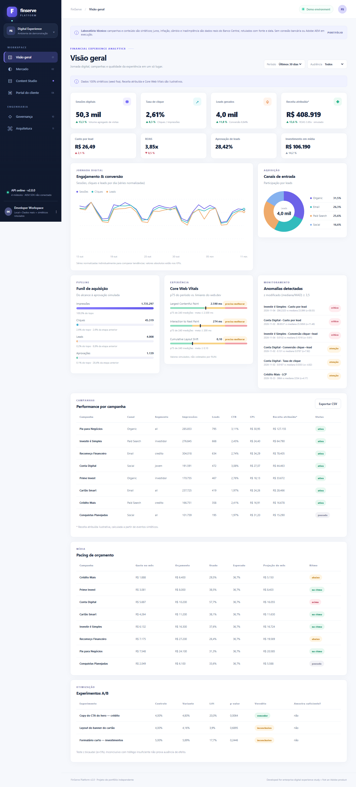</a>
  <a href="docs/images/dashboards/02-mercado-banco-central.png">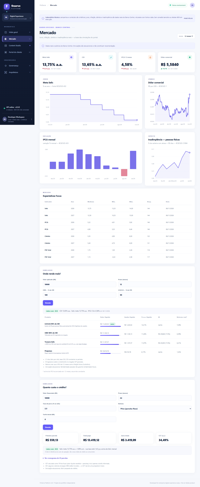</a>
</p>
<p align="center"><sub><b>Visão geral</b> (sintético): KPIs com variação, funil, Core Web Vitals, anomalias, pacing e A/B · <b>Mercado</b> (real): séries do BCB, Focus e simuladores.</sub></p>

<p align="center">
  <a href="docs/images/dashboards/04-simulador-investimento.png">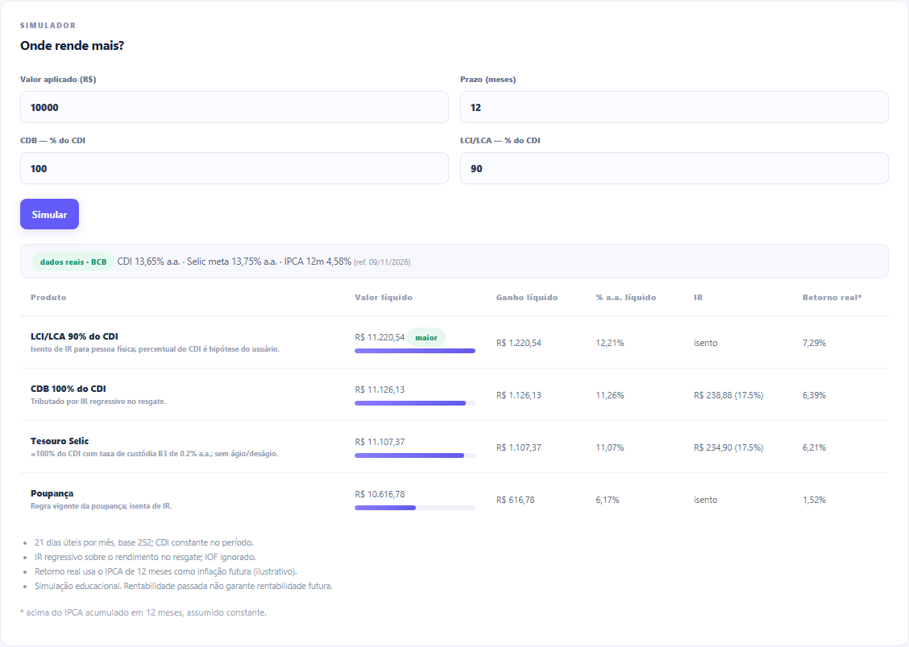</a>
  <a href="docs/images/dashboards/05-simulador-credito.png">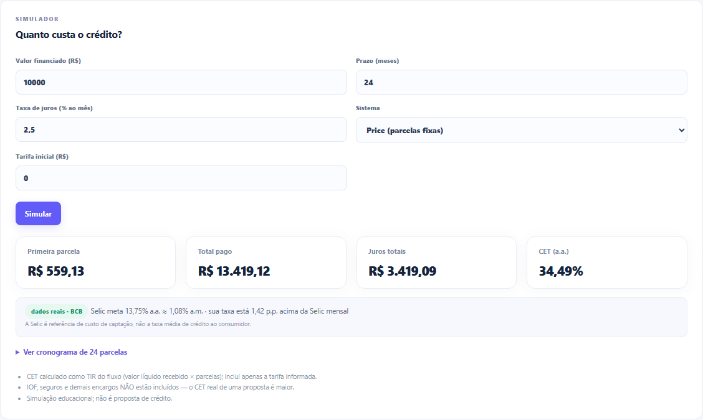</a>
</p>
<p align="center"><sub>Simuladores com insumos reais: comparação líquida de CDB, LCI/LCA, Tesouro Selic e poupança · Price/SAC com CET e contexto da Selic.</sub></p>

### Content Studio

<p align="center">
  <a href="docs/images/content/01-studio-compliance-bloqueio.png">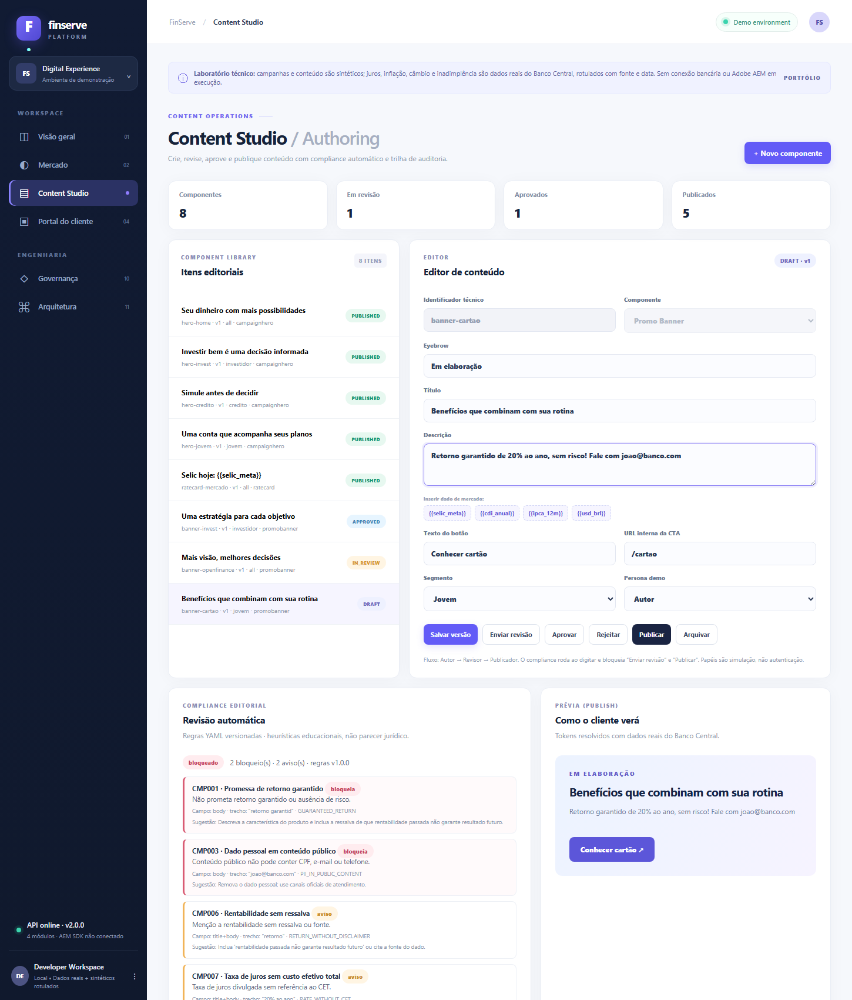</a>
  <a href="docs/images/content/02-studio-versoes-diff-auditoria.png">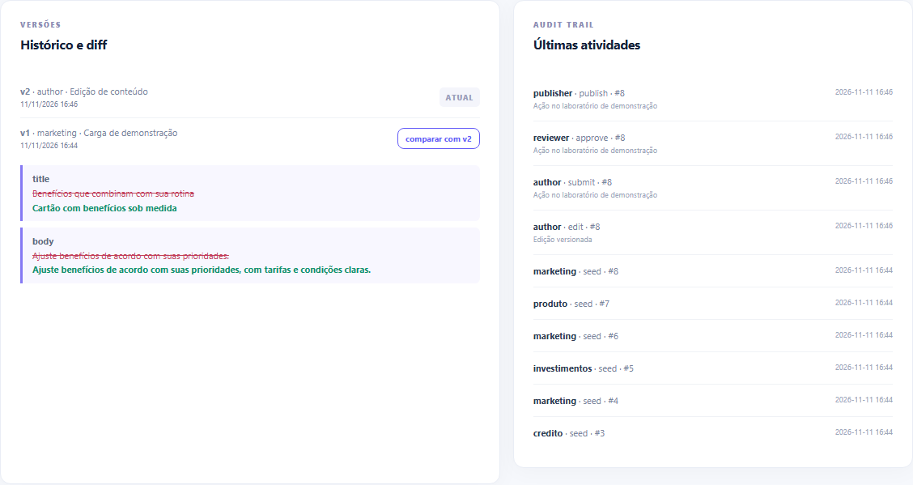</a>
</p>
<p align="center"><sub>Compliance ao digitar: “retorno garantido” e e-mail em conteúdo público bloqueiam o envio · Diff entre versões e trilha de auditoria após o workflow completo.</sub></p>

### Portal e entrega headless

<p align="center">
  <a href="docs/images/portal/01-portal-publico.png"></a>
  <a href="docs/images/portal/03-entrega-headless-model-json.png">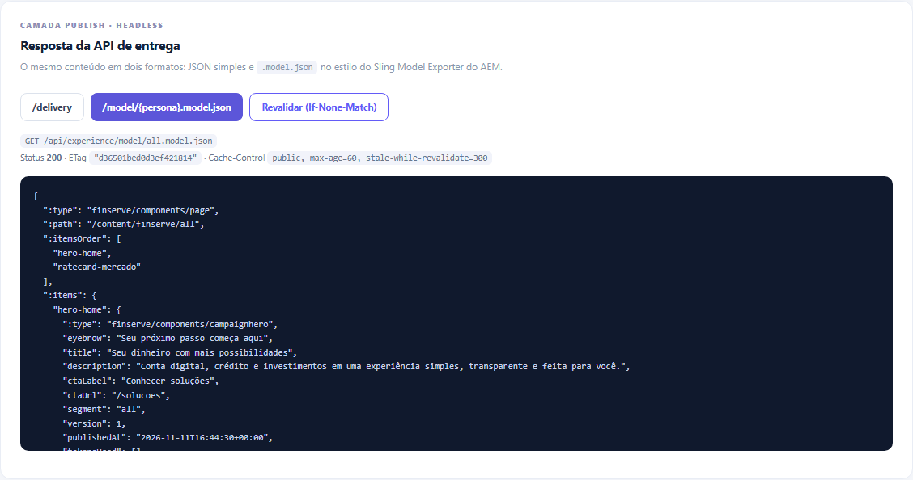</a>
</p>
<p align="center"><sub>Portal: só conteúdo publicado, com Selic/CDI/IPCA resolvidos na entrega · Payload <code>.model.json</code> com <code>ETag</code>, <code>Cache-Control</code> e revalidação 304.</sub></p>

### Plataforma

<p align="center">
  <a href="docs/images/platform/01-governanca-proveniencia.png">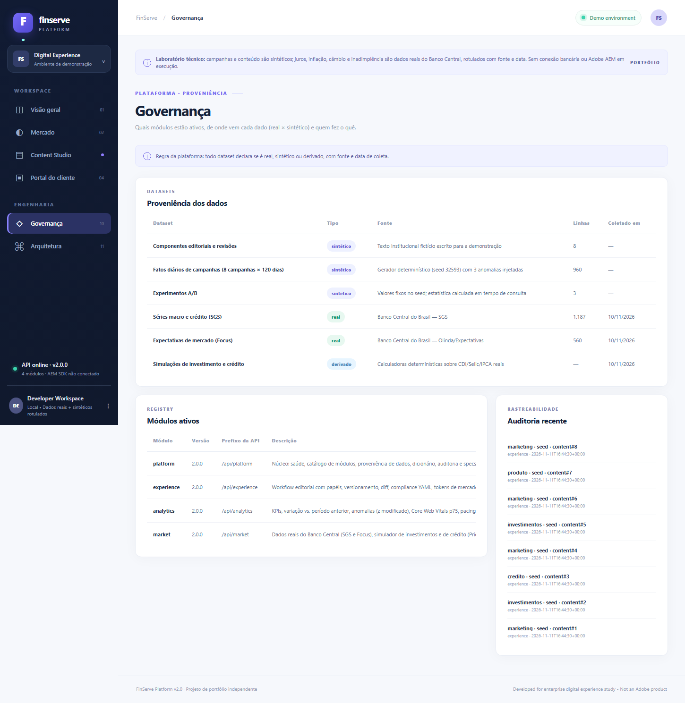</a>
  <a href="docs/images/platform/02-arquitetura-modulos.png">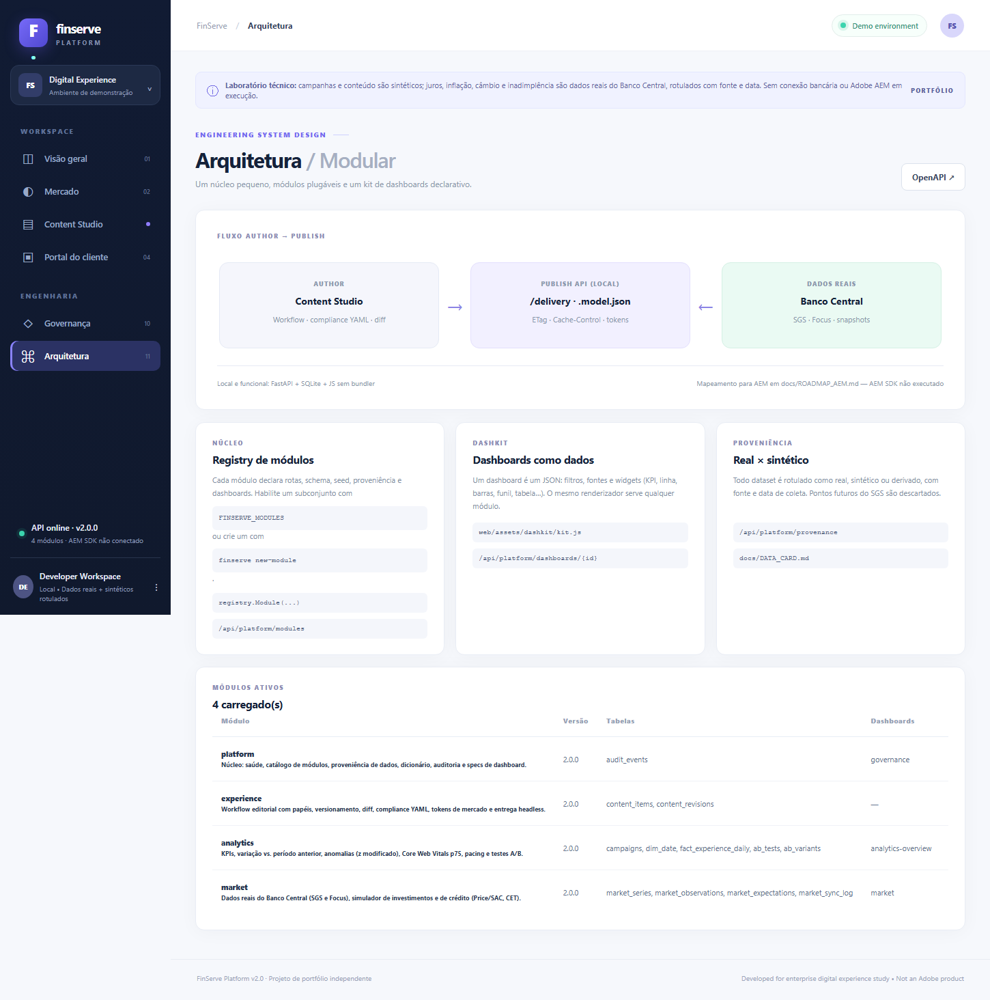</a>
  <a href="docs/images/platform/03-openapi.png">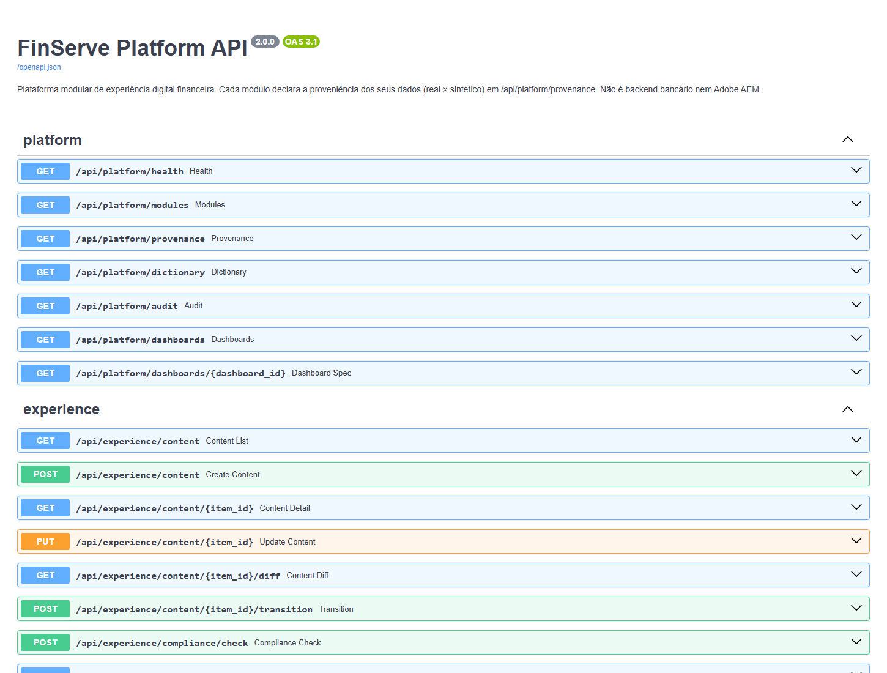</a>
</p>
<p align="center"><sub>Proveniência real × sintético × derivado · Módulos ativos lidos do registry · Documentação OpenAPI gerada pela API.</sub></p>

### Mobile

<p align="center">
  <a href="docs/images/mobile/01-mercado.png">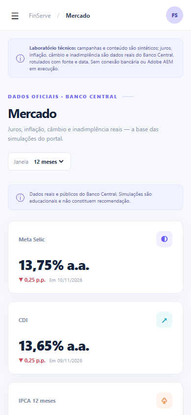</a>
  <a href="docs/images/mobile/02-portal.png"></a>
  <a href="docs/images/mobile/03-studio.png">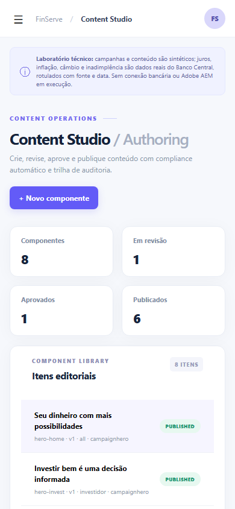</a>
</p>
<p align="center"><sub>Layout responsivo a 390 px sem rolagem horizontal (verificado no E2E).</sub></p>

## 🚀 Aplicações

- Estudo e demonstração de governança editorial em comunicação de produtos financeiros.
- Base para painéis operacionais declarativos reutilizáveis em outros projetos (dashkit + registry).
- Exemplo de integração de dados públicos com proveniência, snapshot offline e sincronização segura.
- Material didático sobre entrega headless e cache (ETag, 304, TTL curto) e sobre o contrato do AEM Publish.

Não é um produto para operar dinheiro, contas ou crédito reais.

## 🔭 Visão de Longo Prazo

```text
v2.0  plataforma modular local · dashkit · dados BCB · compliance · simuladores        (hoje)
  ↓
v2.1–v2.4  CI completo + Docker · Pix Open Data e taxas de crédito · A/B editorial · analytics com sazonalidade e poder
  ↓
v3.0  OIDC/RBAC real · PostgreSQL · outbox de eventos · OpenTelemetry
  ↓
v3.1  módulos de risco (Risco de Crédito) e antifraude (Pix-Fraud-Decisioning-Lab) como módulos externos
  ↓
v4.0  validação em AEM SDK: Content Fragments, persisted queries, Dispatcher, Cloud Manager
```

## 🗺️ Roadmap

- **F0 — Núcleo modular** ✅ Concluída — registry, CLI, scaffold e testes.
- **F1 — Dados reais** ✅ Concluída — 7 séries SGS + Focus, snapshots, proveniência.
- **F2 — Analytics e experiência** ✅ Concluída — anomalias, pacing, A/B; compliance, diff, entrega headless.
- **F3 — Front declarativo** ✅ Concluída — dashkit validado em navegador e mobile.
- **F4 — Qualidade contínua (v2.1)** ⏳ Planejada — CI recorrente, cobertura, ruff, E2E no CI, Docker.
- **F5 — Dados ampliados (v2.2)** ⏳ Planejada — Pix Open Data, taxas médias de crédito verificadas, histórico do Focus, snapshot semanal por PR.
- **F6 — Conteúdo (v2.3)** ⏳ Planejada — agendamento, A/B editorial, exceções de compliance, acessibilidade, i18n.
- **F7 — Analytics robusto (v2.4)** ⏳ Planejada — sazonalidade no detector, alerta de *underpowered*, coortes.
- **F8 — Plataforma real (v3.0)** ⏳ Planejada — OIDC/RBAC, PostgreSQL, observabilidade.
- **F9 — Risco e antifraude (v3.1)** ⏳ Planejada — módulos externos reaproveitando o portfólio.
- **F10 — AEM (v4.0)** 🔒 Depende de licença do SDK.

Entregáveis e critérios de aceite de cada fase: [`ROADMAP.md`](ROADMAP.md).

## 🕓 Histórico e Mudanças

| Versão | Data | O que mudou |
|---|---|---|
| v2.0.0 | 2026-11-11 | reescrita modular: núcleo + 4 módulos, dados reais do BCB, simuladores, compliance, dashkit, relatório reproduzível, 114 testes, CI |
| v1.0.0 | 2026-11-10 | dashboard sintético + Content Studio + portal em um único módulo, 7 testes (não publicada) |

Detalhes: [`CHANGELOG.md`](CHANGELOG.md).

## 🔮 Próximos Passos

- ✅ **Concluídos nesta versão:** núcleo modular · dados reais com proveniência · simuladores · compliance · dashkit · relatório de referência · 7 ADRs e Data Card.
- 🤝 **Dependem de terceiros/ambiente:** SDK e licença do AEM; reconfirmação do endpoint de Pix Open Data e dos códigos de taxas médias de crédito no BCB.
- 🔧 **O que eu faria numa v2.1:** E2E e cobertura no CI; Docker; alerta de experimento *underpowered*; detector com sazonalidade semanal; autenticação real no lugar do `X-Demo-Role`.

## ▶️ Como rodar localmente

Pré-requisitos: Python ≥ 3.10 com `fastapi uvicorn pydantic pyyaml` (e `pytest httpx` para os testes). Ao trabalhar em pasta sincronizada (Drive/OneDrive), use o Python global ou um ambiente **fora** dela.

```bash
# a partir da raiz do repositório
python run.py                                    # http://127.0.0.1:8000  ·  OpenAPI em /docs
python -m pytest                                 # 114 testes, sem rede

export PYTHONPATH=src                            # PowerShell: $env:PYTHONPATH="src"
python -m finserve check                         # valida specs de dashboard e regras de compliance
python -m finserve modules                       # módulos carregados
python -m finserve report                        # regenera reports/metrics.json e reports/report.md
python -m finserve market-sync                   # atualiza os dados reais (rede)
python -m finserve market-snapshot               # regrava data/snapshots/ (rede)
python -m finserve dictionary > docs/DATA_DICTIONARY.md
python -m finserve new-module cartoes            # cria um módulo novo + teste
```

| Ambiente | Estado |
|---|---|
| Windows 11 + Python 3.10.8 (Git Bash) | ✅ verificado nesta revisão |
| CI: Ubuntu e Windows, Python 3.10 e 3.12 | ver badge no topo |
| PowerShell, Linux/macOS locais | **não verificados** nesta revisão |
| `pip install -e .` e o comando `finserve` | declarados no `pyproject.toml`, **não verificados** |
| Docker | não incluído (planejado na v2.1) |

Dica: ao rodar de pasta sincronizada, aponte o banco para disco local — `FINSERVE_DB=/caminho/local/finserve.sqlite3 python run.py`. E2E de navegador (opcional): instruções no topo de [`scripts/e2e_browser.py`](scripts/e2e_browser.py).

## 📁 Estrutura do repositório

```text
.
├── src/finserve/
│   ├── app.py              application factory (create_app)
│   ├── registry.py         descoberta e validação de módulos
│   ├── dashkit.py          contrato e validador de specs de dashboard
│   ├── report.py           relatório de referência reproduzível
│   ├── cli.py · db.py · audit.py · config.py
│   └── modules/
│       ├── platform/       saúde, módulos, proveniência, auditoria, specs
│       ├── experience/     workflow, compliance_rules.yaml, entrega headless
│       ├── analytics/      KPIs, stats.py, seed sintético com gabarito, A/B
│       └── market/         bcb.py (cliente), store.py (sync/snapshot), calculators.py
├── web/                    index.html · assets/{app.js, theme.css, dashkit/, pages/}
├── data/snapshots/         séries reais do BCB (JSON com data de coleta)
├── reports/                metrics.json e report.md (execução de referência)
├── tests/                  7 arquivos de teste + conftest.py (114 testes)
├── docs/
│   ├── ARCHITECTURE.md · DATA_CARD.md · DATA_DICTIONARY.md · DASHKIT.md · MODULES.md · SECURITY.md · ROADMAP_AEM.md
│   ├── adr/                7 decisões de arquitetura
│   └── images/             dashboards/ · content/ · portal/ · platform/ · mobile/
├── aem-reference/          Java/HTL/Granite/TS de referência (NÃO compilado)
├── scripts/                e2e_browser.py (Playwright, opcional)
├── .github/workflows/      ci.yml
├── ROADMAP.md · CHANGELOG.md · LICENSE · pyproject.toml · Makefile · run.py
```

Não versionado (ver [`.gitignore`](.gitignore)): bancos `*.sqlite3`, caches Python, ambientes virtuais, `node_modules`, segredos e qualquer material pessoal, de vaga/entrevista, brainstorm ou conversa com IA.

## 📚 Documentação

| Documento | Conteúdo |
|---|---|
| [`docs/ARCHITECTURE.md`](docs/ARCHITECTURE.md) | containers, regras de projeto, semântica dos KPIs, integração AEM |
| [`docs/DATA_CARD.md`](docs/DATA_CARD.md) | o que é real × sintético, fontes, códigos SGS, anomalias injetadas |
| [`docs/DATA_DICTIONARY.md`](docs/DATA_DICTIONARY.md) | tabelas e colunas (gerado do schema real) |
| [`docs/DASHKIT.md`](docs/DASHKIT.md) | contrato de spec e catálogo de widgets |
| [`docs/MODULES.md`](docs/MODULES.md) | criar, habilitar e distribuir módulos |
| [`docs/SECURITY.md`](docs/SECURITY.md) | controles existentes e o que falta para produção |
| [`docs/ROADMAP_AEM.md`](docs/ROADMAP_AEM.md) | lacunas e critérios para uma integração AEM real |
| [`docs/adr/`](docs/adr/) | 0001 registry · 0002 dashkit · 0003 dados reais · 0004 compliance · 0005 SQLite · 0006 headless · 0007 calculadoras |
| [`reports/report.md`](reports/report.md) | execução de referência (fonte dos números deste README) |
| [`ROADMAP.md`](ROADMAP.md) · [`CHANGELOG.md`](CHANGELOG.md) | planejamento e histórico |

## ⚠️ Limitações

- **Sem autenticação real:** `X-Demo-Role` não é segurança; a aplicação faz bind em `127.0.0.1` e não deve ser exposta ([`docs/SECURITY.md`](docs/SECURITY.md)).
- **AEM não executado:** o `.model.json` imita a forma do Sling Model Exporter; o código em `aem-reference/` não foi compilado nem implantado.
- **Compliance heurístico:** regex educacional, não parecer jurídico; falsos positivos e negativos são possíveis.
- **Simuladores simplificados:** IOF, seguros e encargos fora do CET; 21 dias úteis/mês; inflação futura = IPCA de 12 meses; poupança com TR informada. Não são recomendação nem proposta.
- **Dados:** o snapshot envelhece (a UI mostra a data de coleta e a flag `stale`); Pix Open Data e taxas médias de crédito não integrados; receita, custos, CWV e A/B sintéticos.
- **Estatística:** o detector não modela sazonalidade semanal; o experimento “vencedor” tem amostra menor que a planejada.
- **Front:** sem zoom/seleção de intervalo; gráficos não se redesenham ao redimensionar a janela (o SVG apenas escala).
- **Concorrência:** SQLite sem WAL, uso single-user.
- **Não verificado nesta revisão:** Linux/macOS e PowerShell locais, instalação editável, navegadores além do Chromium.

## Status

🟡 **MVP técnico funcional (v2.0.0)** — 114 testes e 17/17 verificações de navegador passando; dados reais do Banco Central coletados em 2026-11-10; relatório reproduzível em `reports/`. Pendentes: Docker e E2E no CI, Pix Open Data, validação em AEM real.

## Contexto / Observações

Peça de portfólio **independente**; não afiliada à Adobe nem a qualquer instituição financeira. Nomes de campanhas, produtos e textos são fictícios. Métricas de campanha, testes A/B e Core Web Vitals são **sintéticos**; as séries de mercado são **dados públicos reais** do Banco Central do Brasil, atribuídos em cada widget. Nenhum cliente, produção, usuário ou escala é alegado. As simulações têm finalidade educacional.

## 🔗 Projetos Relacionados

| Projeto | Relação |
|---|---|
| [Pix-Fraud-Decisioning-Lab](https://github.com/Yuri-Fernando/Pix-Fraud-Decisioning-Lab) | origem do padrão de regras YAML com fail-safe e dos ADRs; candidato a módulo antifraude (v3.1) |
| Risco de Crédito | origem da prática de *data card*; candidato a módulo de risco (v3.1) |
| ReconPilot AI | decisões determinísticas e auditáveis por regra |
| [Secure-Banking](https://github.com/Yuri-Fernando/Secure-Banking) | domínio bancário complementar (segurança de aplicativo móvel) |
| [RetentIQ](https://github.com/Yuri-Fernando/RetentIQ) | analytics de churn — mesma preocupação com dados e métricas rastreáveis |

## 🤖 Autor

**Yuri Fernando Dubbern**

Engenharia Elétrica · Ciência da Computação · Inteligência Artificial ·
Sistemas Embarcados · Projeto de Hardware · Pesquisa e Desenvolvimento

[LinkedIn](https://www.linkedin.com/in/yuridubbern) · [GitHub](https://github.com/Yuri-Fernando) · [Lattes](http://lattes.cnpq.br/7151392692642166) · [Linktree](https://linktr.ee/yuri.f.dubbern)

## Licença

MIT — ver [LICENSE](LICENSE).
