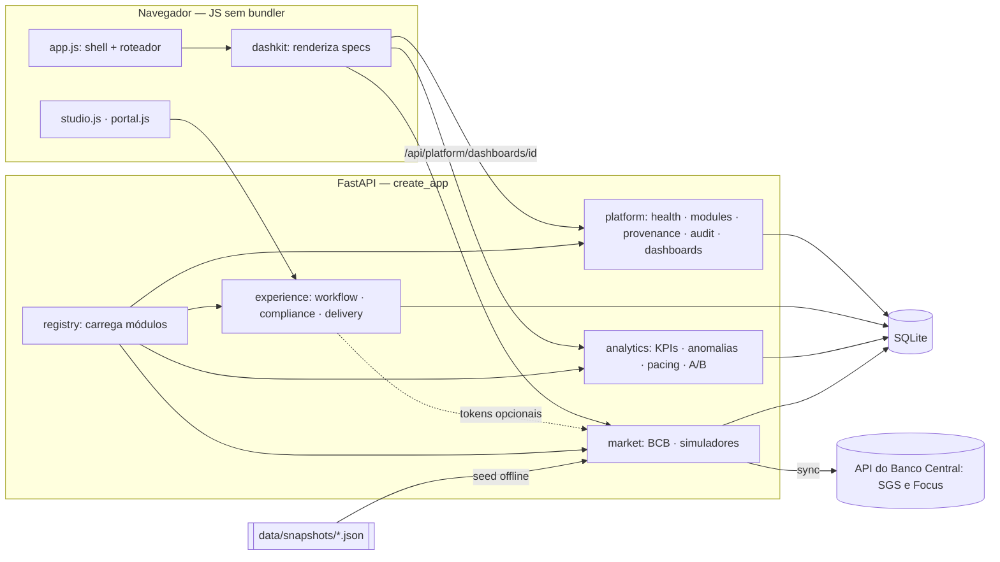

# Arquitetura — FinServe Platform v2

## Objetivo
Uma **plataforma modular de experiência digital financeira** — não um core banking. O problema simulado: marketing de um banco edita campanhas sem deploy, compliance revisa a mensagem, o time de tecnologia acompanha métricas e a vitrine pública mostra taxas de mercado reais. O desenho prioriza **reaproveitamento**: o núcleo é pequeno, cada capacidade é um módulo plugável e os dashboards são dados (dashkit).

## Visão de containers

## Módulos

| Módulo | Responsabilidade | Depende de | Dados |
|---|---|---|---|
| `platform` | saúde, catálogo de módulos, proveniência, dicionário, auditoria, specs de dashboard | — | `audit_events` |
| `experience` | Content Studio (DRAFT→IN_REVIEW→APPROVED→PUBLISHED), versões + diff, compliance YAML, tokens de mercado, entrega headless (ETag, `.model.json`) | `platform` (opcional: `market`) | sintético |
| `analytics` | KPIs com variação vs. período anterior, Core Web Vitals p75, anomalias (z modificado), pacing de orçamento, testes A/B | `platform` | sintético |
| `market` | séries reais do BCB (Selic, CDI, IPCA, IGP-M, dólar, inadimplência), Focus, simulador de investimentos e de crédito | `platform` | **real** |

Contrato de módulo: [MODULES.md](MODULES.md). Contrato de dashboard: [DASHKIT.md](DASHKIT.md).

## Regras de projeto
1. **Proveniência obrigatória** — todo dataset declara `real | synthetic | derived`, fonte, URL e data de coleta (`/api/platform/provenance`). Nunca misturar sem rótulo.
2. **Degradação segura** — sem o módulo `market`, tokens como `{{selic_meta}}` resolvem para `—`; nunca para valor inventado ou token cru.
3. **Fail-safe de compliance** — erro do motor bloqueia o conteúdo (herdado do padrão de regras do Pix-Fraud-Decisioning-Lab).
4. **Cálculo puro e testável** — `calculators.py` e `stats.py` não fazem I/O e listam as premissas na própria resposta.
5. **Sem dado pessoal** — nenhum CPF, conta ou saldo; o motor de compliance bloqueia CPF/e-mail/telefone em conteúdo público.

## Semântica dos KPIs (analytics)
- `CTR = cliques / impressões` · `conversão = leads / cliques` · `aprovação = aprovações / leads` · `CPL = gasto / leads` · `ROAS = receita atribuída / gasto` (receita sintética).
- Variação vs. período anterior só existe quando a janela anterior tem **todos** os dias; senão `delta = {}` (nunca extrapolar).
- Core Web Vitals: **p75** do período contra limiares do web.dev (LCP 2,5 s/4 s · INP 200/500 ms · CLS 0,1/0,25). Valores sintéticos.
- Anomalias: z modificado de Iglewicz–Hoaglin (`0,6745·(x−mediana)/MAD`), limiar 3,5, por campanha e métrica, janela-base de 90 dias.
- Pacing: gasto do mês até hoje ÷ orçamento mensal, comparado ao ritmo linear esperado (acima >110% · abaixo <85%).
- A/B: teste z bicaudal de duas proporções (α=5%), IC 95% e tamanho de amostra por variante para um efeito relativo mínimo de 10%.

## Integração com Adobe AEM (estudo)
O projeto **não executa AEM**. A camada `experience` espelha, localmente, o que o AEM Publish faria: entrega somente de conteúdo publicado, `Cache-Control` + `ETag` (revalidação 304) e o formato `:type / :items / :itemsOrder` do Sling Model Exporter. O mapeamento para Content Fragments, HTL, Dispatcher e Cloud Manager está em [ROADMAP_AEM.md](ROADMAP_AEM.md); o código Java/HTL de referência em `aem-reference/` **não foi compilado** contra um SDK.

## Decisões (ADRs)
[0001 Registry de módulos](adr/0001-registry-de-modulos.md) · [0002 Dashboards como dados](adr/0002-dashboards-como-dados.md) · [0003 Dados reais com snapshot e proveniência](adr/0003-dados-reais-snapshot-proveniencia.md) · [0004 Compliance em YAML com fail-safe](adr/0004-compliance-yaml-fail-safe.md) · [0005 SQLite fora do Drive](adr/0005-sqlite-fora-do-drive.md) · [0006 Entrega headless sem simular AEM](adr/0006-entrega-headless-sem-simular-aem.md) · [0007 Calculadoras puras com premissas explícitas](adr/0007-calculadoras-puras.md)
